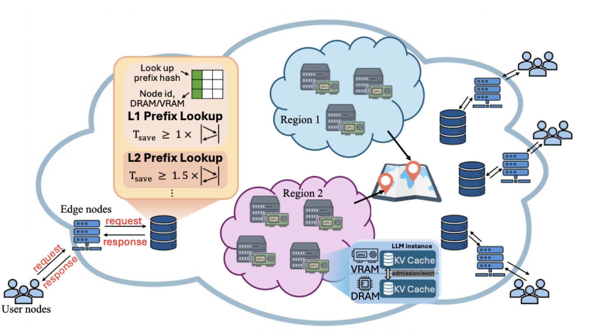

# KVCompass

📄 **Paper:** [KVCompass: A Discovery Plane for Internet-Scale Prefix Cache Sharing in LLM Serving](https://doi.org/10.1145/3857371), Proc. ACM Meas. Anal. Comput. Syst. 10, 3 (SIGMETRICS 2027)

KVCompass is a KV cache discovery plane for Internet-scale prefix cache sharing
in LLM serving. It tracks where reusable prefix KV caches reside across
geographic regions with a compact keyless Ludo index replicated at every edge
node, and forwards each request with a joint score over cache reuse, worker
load, network latency, and storage tier.

## 📃 Overview



This repository contains the two artifacts evaluated in the paper, built around
a shared implementation of the discovery index.

| Component | Paper | Package | What it does |
|-----------|-------|---------|--------------|
| Discovery index | §3 | [`realmachine/src/ludo/`](realmachine/README.md) | Multi-level keyless Ludo table (C++ Smash backend + pybind11 binding) mapping prefix hashes to holder node and storage tier |
| Real-machine prototype | §4, §5.2 | [`realmachine/ludo_sglang/`](realmachine/README.md) | SGLang-integrated discovery plane: edge routers, discovery authority, gossip, tiered workers, trace replay — 8 routing schemes behind one `SCHEME` switch |
| Event-driven simulator | §5.3, §6, Appendices | [`simulation/`](simulation/README.md) | Large-scale evaluation (64 workers / 8 regions and up) with no GPU required; reuses the prototype's native Ludo table |

```
.
├── docs/                      # Figures used in this README
├── simulation/                # Event-driven simulator (large-scale evaluation)
│   ├── simulate.py            # Core trace-driven simulation framework
│   ├── run_section3.py        # Main driver (latency/throughput figures, robustness knobs)
│   ├── fig_mg1.py             # M/G/1 queueing analysis
│   ├── scripts/               # Motivation analyses (WildChat/LMSYS, eviction, trace replay)
│   └── datasets/              # Dataset placement (not shipped; see its README)
├── realmachine/               # Real-machine prototype (SGLang integration)
│   ├── src/ludo/              # Ludo index: C++ binding + Python tables
│   ├── deps/                  # Vendored Smash/Ludo hashing (see DEPS_MANIFEST.txt)
│   ├── ludo_sglang/           # Router, authority, gossip, worker patch, workloads
│   ├── experiments/           # p1_micro / p2_mem / p3_falsehit index benchmarks
│   └── scripts/               # Fleet setup and experiment drivers (aws/, vast/)
├── DEPS_MANIFEST.txt          # Commit pins for vendored and referenced dependencies
├── CITATION.cff
└── LICENSE
```

## 📚 Repository Overview

Each artifact has its own `README.md` with detailed usage.

- **[`simulation/`](simulation/README.md)**: trace-driven, event-based simulator
  of the discovery plane. Models serving nodes with cost functions calibrated
  on Llama-3.1 (8B/70B); implements KVCompass and six baseline routing schemes.
- **[`realmachine/`](realmachine/README.md)**: the deployed prototype. A FastAPI
  edge router in front of an SGLang fleet, with the Ludo discovery index, a
  discovery authority, inter-edge gossip, and a worker-side patch that
  advertises SGLang's HiRadixCache contents (VRAM/DRAM tier) into the index.
- **[`simulation/datasets/`](simulation/datasets/README.md)**: where the
  workload datasets go and how each is derived from its public release.
- **[`DEPS_MANIFEST.txt`](DEPS_MANIFEST.txt)**: commit pins for the vendored
  Ludo hashing implementation and for every upstream system consulted when
  modeling the baselines.

> **Datasets and models are not shipped.** The simulator's workloads are
> derived from public releases (ToolBench, APPS, LooGLE, WildChat-1M,
> LMSYS-Chat-1M) — see [`simulation/datasets/README.md`](simulation/datasets/README.md).
> The real-machine prototype serves stock Hugging Face models through SGLang;
> no model weights are bundled.

## ⚙️ Installation

```bash
python -m venv .venv && source .venv/bin/activate
cd realmachine
pip install -r requirements.txt
bash scripts/setup/build_ludo.sh   # compiles src/ludo against deps/smash
```

The simulator picks up the native Ludo binding automatically, so the simulation
exercises the exact data structure deployed on the testbed. If the binding is
absent it falls back to a semantically identical Python dict with a warning
(`LUDO_TABLE_BACKEND=native|dict` selects explicitly).

A CUDA GPU is required only for the real-machine prototype. `sglang` is
deliberately not in `requirements.txt` — install it per machine to match the
host CUDA version (see the note in [`realmachine/requirements.txt`](realmachine/requirements.txt)).
The simulator and the index benchmarks run on CPU.

## 🚀 Quick Start

Run a fast debug pass of the large-scale simulation (no GPU, no datasets
needed beyond the ones you place under `simulation/datasets/`):

```bash
cd simulation
pip install -r requirements.txt
python3 run_section3.py --quick --workload mixed
```

This sweeps arrival rates over all routing schemes and writes
`fig1_latency_throughput.pdf`, `fig2_ttft_cdf.pdf`, `fig3_flops_saved.pdf`,
and `fig4_heatmap.pdf` to `simulation/results/`. Drop `--quick` for the
paper-scale run.

To bring up the real-machine prototype on a GPU fleet, start from
[`realmachine/README.md`](realmachine/README.md).

## 🔬 Reproducing the paper's experiments

| Paper | Experiment | Entry point |
|-------|------------|-------------|
| §2 | Motivation: cross-region reuse on WildChat/LMSYS | `simulation/scripts/wildchat_analysis/` |
| §2 | Motivation: eviction policies | `simulation/scripts/evict_analysis/evict_motivation.py` |
| §3.5 | M/G/1 queueing analysis | `simulation/fig_mg1.py` |
| §5.2 | Real-machine testbed validation | `realmachine/scripts/vast/run_multiregion_vast.sh` (or `scripts/aws/run_multiregion.sh`) |
| §5.3 | Large-scale simulation (64 workers / 8 regions) | `simulation/run_section3.py --figs 125 --workload {mixed,wildchat,lmsys} --n-tenants 50` |
| §5.4 | Ablation study (real machine) | `realmachine/scripts/vast/run_ablation.sh` |
| §5.5 | Index operation microbenchmarks | `realmachine/experiments/p1_micro/build.sh && ./p1_bench` |
| §6.1 | Discovery-index memory footprint | `realmachine/experiments/p2_mem/run_p2_full.sh` |
| §6.2 | Robustness to WAN jitter and update loss/delay | same simulation driver with `SIM_WAN_JITTER` / `SIM_UPDATE_LOSS` / `SIM_UPDATE_DELAY_MS` |
| §6.3 | False hits in the keyless index | `realmachine/experiments/p3_falsehit/` (`fp_microbench.py`, `e2e_false_lookup.py`) |
| Appendix | 16-region / 128-worker simulation | same driver with the 16-region configuration in `simulate.py` |
| Appendix | Production-trace replay (Bailian/Mooncake) | `simulation/scripts/trace_analysis/replay_traces.py` |

## 🙏 Acknowledgements

- The discovery index builds on
  [Ludo hashing](https://users.soe.ucsc.edu/~qian/papers/LudoHashing.pdf)
  (SIGMETRICS 2020); the [Smash](https://github.com/yliu634/Smash)
  implementation is vendored under `realmachine/deps/`.
- The prototype integrates with [SGLang](https://github.com/sgl-project/sglang)
  and advertises its HiRadixCache contents into the discovery plane
  (see `realmachine/ludo_sglang/worker/SGLANG_TIER_PATCH.md`).
- Baseline schemes were modeled against their upstream implementations
  (PlanetServe, SkyWalker, Mooncake, LMCache, CacheGen, Preble, vLLM),
  pinned by commit in [`DEPS_MANIFEST.txt`](DEPS_MANIFEST.txt).

## License

MIT, see [LICENSE](LICENSE). Vendored third-party components under
`realmachine/deps/` keep their own licenses.

## Citation

If you use KVCompass in your research, please cite our paper:

```bibtex
@article{ling2026kvcompass,
  author    = {Ling, Shiyi and Fang, Fei and Qian, Chen},
  title     = {KVCompass: A Discovery Plane for Internet-Scale Prefix Cache Sharing in LLM Serving},
  journal   = {Proceedings of the ACM on Measurement and Analysis of Computing Systems},
  volume    = {10},
  number    = {3},
  articleno = {68},
  month     = dec,
  year      = {2026},
  doi       = {10.1145/3857371}
}
```
